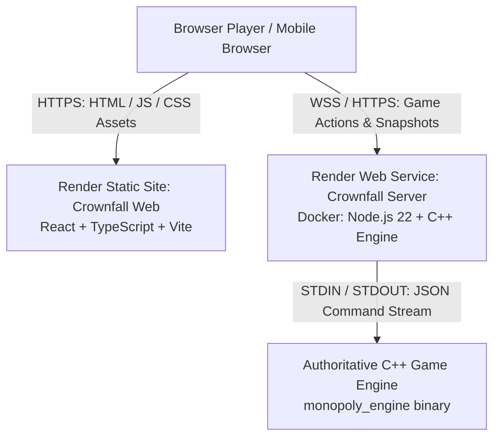

# Crownfall — Render Free Tier Deployment Guide

This guide details the deployment of **Crownfall** as a public browser multiplayer game hosted on **Render** under the **Free Tier**.

---

## 1. System Architecture



- **Frontend**: Render Static Site built with Vite, outputting to `dist/`.
- **Backend**: Render Web Service built with a multi-stage Dockerfile containing:
  1. Debian build stage compiling the authoritative C++ engine with `g++` and optimizations (`-O3`).
  2. Node.js 22 runtime stage running `scripts/multiplayer_server.cjs` (RFC 6455 WebSocket + HTTP dual transport).
- **Transport**: Encrypted Secure WebSocket (`wss://`) and secure HTTP (`https://`) terminated by Render's TLS reverse proxy.
- **Data Persistence**: In-memory room state. No external database or paid services required.

---

## 2. Render Free Tier Characteristics & Policies

| Attribute | Behavior on Render Free Tier |
|---|---|
| **Monthly Cost** | **$0.00** (Completely free for hobby releases) |
| **Server RAM / CPU** | 512 MB RAM, 0.1 vCPU shared |
| **Inactivity Sleep** | Web Service spins down after **15 minutes** of no incoming traffic |
| **Cold Start Duration** | Waking from sleep takes **~45 to 60 seconds** on the first request |
| **In-Memory Games** | Active games do **not** survive server sleep or restarts |
| **Keep-Alive Policy** | **No artificial keep-alive traffic** is implemented. The application adheres to Render's free tier terms |
| **Frontend Communication** | Crownfall detects cold starts and displays: `⏳ Server Waking Up (Render free tier cold start: ~50s)...` with a manual ping retry button |

---

## 3. Deployment Method A: Automated via Render Blueprint (`render.yaml`)

The repository includes a [render.yaml](file:///d:/Monopoly/render.yaml) blueprint specification for 1-click deployment.

### Steps:
1. Push your repository to your GitHub or GitLab account.
2. Sign in to your **[Render Dashboard](https://dashboard.render.com)**.
3. Click **New +** in the top navigation bar and select **Blueprint**.
4. Connect your Crownfall repository.
5. Render will automatically detect `render.yaml` and configure:
   - `crownfall-server` (Docker Web Service, Plan: Free, Health check: `/api/health`)
   - `crownfall-web` (Static Site, Plan: Free, Publish: `dist`, Rewrite: `/*` -> `/index.html`)
6. Once `crownfall-server` finishes building, copy its assigned domain (e.g., `https://crownfall-server.onrender.com`).
7. In the Render Dashboard under `crownfall-web` > **Environment**, update `VITE_MULTIPLAYER_SERVER_URL` to match your server URL, and trigger a redeploy of the static site.

---

## 4. Deployment Method B: Manual Service Setup

If you prefer to configure each service manually in the Render dashboard:

### Step 1: Deploy the C++ Multiplayer Server (Web Service)

1. In the Render Dashboard, click **New +** > **Web Service**.
2. Connect your Git repository.
3. Fill in the service parameters:
   - **Name**: `crownfall-server`
   - **Region**: Any free tier region (e.g., *Oregon (US West)* or *Frankfurt (EU Central)*)
   - **Language / Runtime**: **Docker**
   - **Instance Type**: **Free**
   - **Dockerfile Path**: `./Dockerfile`
   - **Docker Context**: `.`
4. Under **Advanced**:
   - **Health Check Path**: `/api/health`
5. Click **Create Web Service**.
6. Note the public URL provided by Render upon deployment:
   ```
   https://<your-server-name>.onrender.com
   ```

### Step 2: Deploy the Browser Frontend (Static Site)

1. In the Render Dashboard, click **New +** > **Static Site**.
2. Connect your Git repository.
3. Fill in the build settings:
   - **Name**: `crownfall-web`
   - **Branch**: `main` (or your default branch)
   - **Build Command**: `pnpm install && pnpm build` (or `npm run build`)
   - **Publish Directory**: `dist`
4. Under **Environment Variables**, add:
   - **Key**: `VITE_MULTIPLAYER_SERVER_URL`
   - **Value**: `https://<your-server-name>.onrender.com` (use the URL from Step 1)
5. Under **Redirects/Rewrites**:
   - Click **Add Rule**
   - **Type**: `Rewrite`
   - **Source**: `/*`
   - **Destination**: `/index.html`
6. Click **Create Static Site**.

---

## 5. Verification & Health Checks

Once deployed, you can verify your deployment manually:

### 1. Backend Health Check
Open your browser or run curl against your server's health endpoint:
```bash
curl https://<your-server-name>.onrender.com/api/health
```
Expected response:
```json
{
  "ok": true,
  "status": "online",
  "platform": "render",
  "version": "1.0.0",
  "uptimeSeconds": 42,
  "memoryUsage": { ... },
  "activeConnections": 0,
  "roomsCount": 0,
  "connectedPlayers": 0,
  "engineBinary": "/app/bin/monopoly_engine",
  "engineAvailable": true
}
```

### 2. Cold Start Verification
When accessing the static website after the server has slept:
1. Open your static site URL: `https://<your-web-name>.onrender.com`.
2. Notice the network badge at the top: `⏳ WAKING UP (~50s)`.
3. Notice the amber notice banner informing users of Render's free tier spin-up.
4. Once Render initializes the container, the pill automatically transitions to: `🟢 ONLINE` / `🟢 SERVER ONLINE`.

### 3. Multiplayer Room Flow
1. Click **Create Game**. Choose a name and token color.
2. Share the generated room code (`CRN-XXXX`) with a second browser tab or mobile device.
3. In the second browser, click **Join Game**, enter the room code, and enter the lobby.
4. Verify that:
   - The host and joined player see each other in real time.
   - When the host clicks **START GAME**, both clients transition to the board.
   - Dice rolls, property purchases, mortgages, debt warnings, and chat events synchronize authoritatively.

---

## 6. Environment Variables Reference

| Variable Name | Target | Purpose | Example |
|---|---|---|---|
| `VITE_WS_URL` | Frontend (Build-time) | Direct Secure WebSocket endpoint | `wss://crownfall-server.onrender.com` |
| `VITE_MULTIPLAYER_SERVER_URL` | Frontend (Build-time) | Server base URL (supports `https://` or `wss://`) | `https://crownfall-server.onrender.com` |
| `VITE_TURNSTILE_SITE_KEY` | Frontend (Build-time) | Optional Cloudflare Turnstile site key for client challenge | `0x4AAAAAA...` |
| `PORT` | Backend (Runtime) | Port injected automatically by Render | `10000` |
| `HOST` | Backend (Runtime) | Network interface (must be `0.0.0.0` on Render) | `0.0.0.0` |
| `NODE_ENV` | Backend (Runtime) | Node environment | `production` |
| `TRUST_PROXY` | Backend (Runtime) | Trust proxy headers (`x-forwarded-for`) from Render reverse proxy | `true` |
| `MAX_CONNECTIONS` | Backend (Runtime) | Connection limit to safeguard 512MB RAM | `500` |
| `ENGINE_BIN_PATH` | Backend (Runtime) | Optional C++ binary location override | `/app/bin/monopoly_engine` |
| `CAPTCHA_ENFORCEMENT` | Backend (Runtime) | Enforcement mode: `auto` (enforces when secret set), `strict`, or `off` | `auto` |
| `TURNSTILE_SECRET_KEY` | Backend (Runtime) | Cloudflare Turnstile secret key for server-side verification | `0x4AAAAAA...` |
| `ADMIN_API_KEY` | Backend (Runtime) | Secret key to access `/api/admin/security/events` audit logs | `super-secret-admin-key` |
| `RL_ROOM_CREATE_BURST` | Backend (Runtime) | Max burst tokens for room creation | `5` |
| `RL_ROOM_CREATE_REFILL` | Backend (Runtime) | Token refill rate per second for room creation | `0.2` |
| `RL_ROOM_JOIN_BURST` | Backend (Runtime) | Max burst tokens for room join attempts | `15` |
| `RL_ROOM_JOIN_REFILL` | Backend (Runtime) | Token refill rate per second for room join attempts | `1.0` |
| `RL_JOIN_REQUEST_BURST` | Backend (Runtime) | Max burst tokens for host join responses | `30` |
| `RL_JOIN_REQUEST_REFILL` | Backend (Runtime) | Token refill rate per second for host join responses | `5.0` |
| `RL_RECONNECT_BURST` | Backend (Runtime) | Max burst tokens for reconnection attempts | `10` |
| `RL_RECONNECT_REFILL` | Backend (Runtime) | Token refill rate per second for reconnection attempts | `0.5` |
| `RL_GAMEPLAY_BURST` | Backend (Runtime) | Max burst tokens for gameplay actions per player | `40` |
| `RL_GAMEPLAY_REFILL` | Backend (Runtime) | Token refill rate per second for gameplay actions | `8.0` |
| `RL_API_BURST` | Backend (Runtime) | Max burst tokens for general API requests | `60` |
| `RL_API_REFILL` | Backend (Runtime) | Token refill rate per second for general API requests | `10.0` |

---

## 7. Security Hardening & Abuse Protection Layer

The backend includes a dedicated server-side security layer (`scripts/abuse_protection.cjs`) providing protection against automated spam, credential stuffing, denial-of-service floods, and state corruption:

### 1. In-Memory Monotonic Token-Bucket Rate Limiter
- **Clock**: Driven by high-precision monotonic clock (`process.hrtime.bigint()`), immune to system clock shifts or NTP jumps.
- **Categorized Buckets**:
  - `ROOM_CREATE`: 5 burst, 0.2/sec refill (prevents room creation spam).
  - `ROOM_JOIN`: 15 burst, 1.0/sec refill (prevents brute forcing room codes).
  - `JOIN_REQUEST_RESPOND`: 30 burst, 5.0/sec refill (prevents host response flooding).
  - `RECONNECT`: 10 burst, 0.5/sec refill (prevents reconnection spam).
  - `GAMEPLAY_ACTION`: 40 burst, 8.0/sec refill (protects C++ engine IPC while preserving smooth gameplay).
  - `GENERAL_API`: 60 burst, 10.0/sec refill.
- **Memory Bounded**: Tracks up to 5,000 active keys with a periodic 60-second cleanup sweeper to prevent memory exhaustion in 512MB RAM containers.
- **Scope**: In-memory rate limits reset when the Render container restarts and are local to the instance.
- **IP Extraction**: Controlled by `TRUST_PROXY=true` on Render. When true, safely extracts the first client IP from `X-Forwarded-For`.

### 2. Cloudflare Turnstile Human Verification (CAPTCHA)
- **Zero Third-Party Bundles**: Verified using Node.js built-in `https` module (`https://challenges.cloudflare.com/turnstile/v0/siteverify`).
- **Fail-Closed Semantics**: If CAPTCHA is enforced (`CAPTCHA_ENFORCEMENT=strict` or `auto` with `TURNSTILE_SECRET_KEY` configured), missing or invalid tokens return HTTP 403 `CAPTCHA_FAILED`.
- **Client Fallback**: If Turnstile keys are not configured, `CAPTCHA_ENFORCEMENT=auto` gracefully allows legitimate players to proceed without breaking the game flow.
- **Frontend Integration**: Seamless Turnstile challenge widget rendered during room creation or join request in `SetupScreen`.

### 3. Payload Validation and Connection Limits
- **Max Payload Size**: HTTP request bodies exceeding 64KB are rejected immediately with HTTP 413 `PAYLOAD_TOO_LARGE`.
- **Input Sanitization**: Room codes strictly validated (`^[A-Za-z0-9_-]{3,16}$`), player names sanitized (1–20 characters, control characters stripped), and player colors validated against the authoritative palette.
- **Max Global Connections**: Capped at 500 connections (`MAX_CONNECTIONS`).

### 4. Bounded Security Auditing
- **Event Logger**: In-memory ring buffer storing the latest 200 security events (rate-limit rejections, suspicious IPs, CAPTCHA failures).
- **Log Throttling**: Console output throttled to at most 1 log line every 2 seconds per event category to protect the Node event loop from I/O flooding.
- **Admin Endpoint**: `GET /api/admin/security/events` protected by `ADMIN_API_KEY` (`x-admin-key` header or `?key=` query param) for live security monitoring.

---

## 8. Four-Player Reliability & Synchronization Architecture

Key architectural adjustments made to guarantee stable 4-player multiplayer without bots:

1. **Old Socket Disconnection Drop (The Stale-Socket Close Bug)**:
   - When a player reconnected, the old socket was closed. Node's asynchronous `close` event previously nullified `player.socket = null` even if a new valid socket had already been attached.
   - Fixed by validating `currentPlayer.socket === socket` before triggering disconnect handling.
2. **Authoritative Player ID Realignment**:
   - The authoritative C++ engine indexes players as `0..N-1`. When starting the game, confirmed players receive contiguous engine player IDs.
   - Server room broadcasts now inject each recipient's specific `yourPlayerId: p.id`, ensuring the 4th player and all clients match the engine's active player index and can roll dice without permission errors.
3. **Monotonic Lobby Player IDs**:
   - Player IDs in rooms now use an incrementing counter (`nextPlayerId++`) rather than array indices, preventing ID collisions when players join and leave.
4. **Sequential Room Action Queue**:
   - All state-mutating actions (dice rolls, purchases, mortgages, end turns) are serialized through `room.enqueueAction(taskFn)` to prevent race conditions during asynchronous IPC with the C++ engine.
5. **Reverse Proxy Keep-Alive (Heartbeat)**:
   - Render's edge proxy terminates WebSocket connections after ~55 seconds of inactivity.
   - Added a 25-second server RFC 6455 PING heartbeat and a 25-second client keepalive loop to keep long turns and trade negotiations alive indefinitely.

---

## 9. Troubleshooting

### Issue: "Server Waking Up (~50s)" persists
- **Cause**: Render free tier services take ~45–60 seconds to spin up on cold start.
- **Fix**: Wait ~50 seconds and click the **Retry Check** / **Ping Server** button. Once the container is running, connections connect immediately.

### Issue: WebSocket fails to connect
- **Cause**: The frontend was built with an invalid `VITE_MULTIPLAYER_SERVER_URL` or HTTP/HTTPS mismatch.
- **Fix**: Ensure `VITE_MULTIPLAYER_SERVER_URL` is set to `https://<your-server-name>.onrender.com` in the Render Static Site environment variables, and trigger a **Manual Deploy > Clear build cache & deploy**.

### Issue: Room disappeared after closing tab for 20 minutes
- **Cause**: Under Render Free Tier, the backend service sleeps after 15 minutes of inactivity. Rooms are held in memory.
- **Fix**: This is expected behavior under free-tier constraints. Create a new room code to start a new match.

### Issue: HTTP 429 Too Many Requests
- **Cause**: Rate limit threshold reached for room creation, joining, or action spam.
- **Fix**: Respect the `Retry-After` header sent in the response before retrying.

### Issue: HTTP 403 CAPTCHA_FAILED
- **Cause**: Turnstile human verification failed or was missing when `CAPTCHA_ENFORCEMENT=strict` or `TURNSTILE_SECRET_KEY` is set.
- **Fix**: Complete the Turnstile challenge widget on the lobby setup screen. Ensure both `VITE_TURNSTILE_SITE_KEY` (frontend) and `TURNSTILE_SECRET_KEY` (backend) come from the same Cloudflare Turnstile widget.
